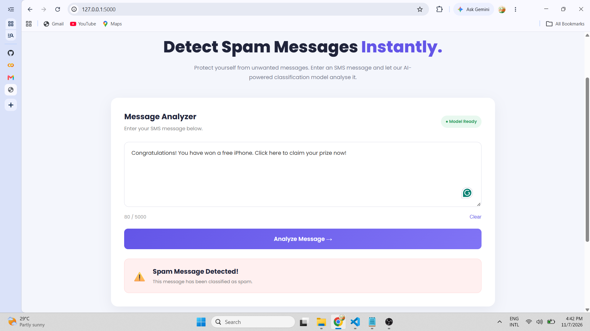

# 🛡️ SpamGuard – Spam Message Detection Web Application

A Machine Learning-powered web application that identifies whether an SMS message is **Spam** or **Not Spam** using Natural Language Processing (NLP) and Multinomial Naive Bayes.

Built with Python, Flask, HTML, CSS, and JavaScript, this project demonstrates how a trained machine learning model can be integrated into a full-stack web application.

---

## 🚀 Project Overview

SpamGuard allows users to enter SMS messages and instantly classify them as spam or legitimate messages.

The application uses a pre-trained NLP model saved as a Pickle file (`spam_model.pkl`) to make predictions without retraining the model every time.

---

## ✨ Features

- SMS spam message classification.
- Real-time message analysis.
- Natural Language Processing (NLP).
- TF-IDF text feature extraction.
- Multinomial Naive Bayes classification.
- Interactive and responsive user interface.
- Python Flask backend API.
- Model persistence using Pickle.

---

## 🛠️ Technologies Used

| Technology | Purpose |
|---|---|
| Python | Backend development |
| Flask | Web framework and API |
| HTML5 | Frontend structure |
| CSS3 | User interface styling |
| JavaScript | Frontend interaction |
| NLTK | Text preprocessing |
| Scikit-learn | Machine Learning |
| TF-IDF | Text feature extraction |
| Multinomial Naive Bayes | Classification algorithm |
| Pickle | Model serialization |

---

## 🧠 Machine Learning Workflow

The application follows these steps:

1. **Text Input:** User enters an SMS message.
2. **Text Preprocessing:** Converts text to lowercase, tokenizes words, removes stopwords and applies stemming.
3. **Feature Extraction:** TF-IDF converts the processed text into numerical features.
4. **Classification:** The Multinomial Naive Bayes model predicts the message category.
5. **Result Display:** The frontend displays Spam or Not Spam.

---

## 📂 Project Structure

```text
Spam-Detection-WebApp/
│
├── app.py
├── spam_model.pkl
├── requirements.txt
├── .gitignore
│
├── templates/
│   └── index.html
│
└── static/
    ├── style.css
    └── script.js
```

---

## ⚙️ Installation and Setup

### 1. Clone the Repository

```bash
git clone https://github.com/Kaveeshamalindi/Spam-Detection-WebApp.git
```

### 2. Navigate to the Project Directory

```bash
cd Spam-Detection-WebApp
```

### 3. Create a Virtual Environment

```bash
python -m venv venv
```

### 4. Activate the Virtual Environment

**Windows PowerShell:**

```powershell
.\venv\Scripts\Activate.ps1
```

**Windows CMD:**

```cmd
venv\Scripts\activate.bat
```

### 5. Install Dependencies

```bash
pip install -r requirements.txt
```

### 6. Run the Application

```bash
python app.py
```

### 7. Open in Your Browser

```text
http://127.0.0.1:5000
```

---

## 📦 Requirements

The project requires:

- Python 3.10 or later (use a version compatible with your installed dependencies).
- Flask
- NLTK
- NumPy
- Scikit-learn

Install the required packages using:

```bash
pip install -r requirements.txt
```

---

## 🧪 Example Predictions

| SMS Message | Expected Classification |
|---|---|
| Congratulations! You have won a free prize! | Spam |
| Hey, are we meeting tomorrow? | Not Spam |
| Claim your FREE gift voucher now! | Spam |
| Thank you for helping me with the project. | Not Spam |

*Note: Actual predictions depend on the trained model.*

---

## 📸 Application Preview

```markdown

```

## 🎯 Learning Outcomes

Through this project, I explored:

- Fundamentals of Natural Language Processing.
- Text preprocessing techniques.
- TF-IDF vectorization.
- Naive Bayes classification.
- Saving and loading trained ML models using Pickle.
- Building REST API endpoints with Flask.
- Integrating Machine Learning models with HTML, CSS, and JavaScript.
- Creating interactive full-stack web applications.

---

## 🔮 Future Improvements

- Add model prediction confidence scores.
- Display prediction history.
- Improve model performance with additional training data.
- Explore additional classification algorithms.
- Deploy the application online.
- Develop a REST API for external integrations.

---

## ⭐ Support

If you find this project useful or interesting, consider giving the repository a ⭐ on GitHub!

---